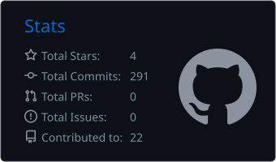
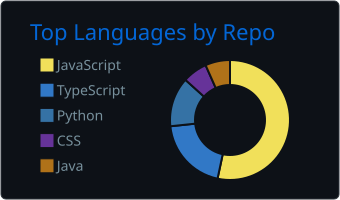

<!--
**Bhavika-Giyanani/Bhavika-Giyanani** is a ✨ _special_ ✨ repository because its `README.md` (this file) appears on your GitHub profile.

Here are some ideas to get you started:

- 🔭 I’m currently working on ...
- 🌱 I’m currently learning ...
- 👯 I’m looking to collaborate on ...
- 🤔 I’m looking for help with ...
- 💬 Ask me about ...
- 📫 How to reach me: ...
- 😄 Pronouns: ...
- ⚡ Fun fact: ...
-->

  

<h1 align="center">Bhavika Giyanani</h1>

  <strong>Software Developer | Full-Stack & GenAI Engineer</strong> 
  📍 Vadodara, Gujarat, India • 🎓 MCA @ MSU Baroda (BCA 9.1 CGPA)

  
  
  
  
  

---

### 💫 About Me

- 🔭 I’m currently building **Generative AI pipelines (RAG, Groq API, LangChain)** and high-performance **Full-Stack applications**.
- 💼 Former **Applied AI Intern** at **IBM SkillsBuild** & **Full-Stack Developer** at **Innvoket Tech LLP**.
- 🏛️ Served as **Backend Team Lead** at **Code Vimarsh (MSU Coding Club)**.
- ♟️ **International FIDE Rated Chess Player** (Achieved 2018) & **4-Time Inter-Faculty Gold Medalist Captain**.
- 🎓 Pursuing **MCA** at MSU Baroda | Graduated **BCA with 9.1 CGPA**.
- 💬 Ask me about **LangChain, Docker, Kubernetes, MongoDB, PostgreSQL, Supabase, React, TypeScript, Node.js, Python, FastAPI, RAG, WebSockets, & Chess Tactics**.
- 📫 Reach out to me: **[bhavikavgiyanani@gmail.com](mailto:bhavikavgiyanani@gmail.com)**

---

### 🛠️ Tech Stack & Tooling

**Languages**

  
  
  
  
  
  
  
  

**Generative AI & LLMs**

  
  
  
  
  
  

**Frontend & Backend**

  
  
  
  
  
  

**Databases, Cloud & DevOps**

  
  
  
  
  
  
  
  
  

---

### 🚀 Featured Projects

#### 🧠 [NotesGraph AI – Lecture-to-Notes & Grounded Lecture Chat](https://github.com/Bhavika-Giyanani/NotesGraph-AI)
> **An end-to-end AI system that turns lecture recordings into timestamped transcripts, structured study notes, and chat answers grounded in what the speaker actually said.**

[🔗 Live Demo](https://notesgraph-ai.onrender.com/) • [💻 Source Code](https://github.com/Bhavika-Giyanani/NotesGraph-AI)

- **Resumable Audio Ingestion**: Uploads up to 500 MB with `tus-js-client` straight to private **Supabase Storage**; processing continues in the background, and audio is chunked with `ffmpeg` and transcribed with **Groq Whisper** while keeping segment-level timestamps. A pasted transcript works too.
- **Structured Note Synthesis**: **Gemini** generates summaries, key concepts, exam-relevant points, announcements, and off-topic remarks, with a Groq fallback if Gemini is temporarily unavailable. Notes export as **PDF** (ReportLab) or **Markdown**.
- **Grounded RAG Chat**: Transcript chunks are embedded with Gemini into **Supabase pgvector** and retrieved per user and lecture; answers cite timestamped passages you can jump to in the recording, and out-of-scope questions are identified instead of guessed.
- **Secure Workspace**: **Supabase Auth**, **Row Level Security**, a private audio bucket, and owner-scoped queries keep every lecture, transcript, note, and chat private. Subject folders, transcript search, and persistent light/dark themes round out the UI.
- **Tech Stack**: `Python` • `FastAPI` • `LangChain` • `Gemini API` • `Groq Whisper` • `Supabase (Auth, PostgreSQL, pgvector, Storage)` • `React` • `TypeScript` • `Tailwind CSS` • `Docker` • `Render`

#### 🌱 [GreenMind – Symbiotic Growth Initiative](https://youtu.be/HGnvS5JjY3E)
> **Team-based CSR sustainability web application promoting ethical learning, productivity, and verified real-world tree planting.**

- **Gamified Growth Modules**: Ethical quizzes (water points), Pomodoro timer (sunlight points), Meditation (soil points).
- **Animated Zen Panda**: Tracks progress across 5 stages with interactive animations (clouds, rain, tree growth).
- **Real-World Impact**: Automatically initiates real tree planting upon user completing level 5.
- **Tech Stack**: `HTML5` • `CSS3` • `JavaScript` • `jQuery` • `Node.js` • `Express` • `MongoDB` • `WebSocket` • `SVGator`

#### 🚚 [TransitOps – Fleet Operations Platform](https://github.com/Bhavika-Giyanani/TransitOps)
> **Role-based fleet operations platform for managing vehicles, drivers, trip dispatch, maintenance, compliance, and fleet financials, with built-in dispatch safety rules.**

[🔗 Live Demo](https://transitops-8req.onrender.com/) • [💻 Source Code](https://github.com/Bhavika-Giyanani/TransitOps)

- **Dispatch Guardrails**: Excludes suspended drivers and vehicles under maintenance, and validates licence status and cargo capacity before a trip can be dispatched.
- **Role-Based Workspaces**: Tailored views and permissions for Organization Admins, Fleet Managers, Drivers, Safety Officers, and Financial Analysts, secured with **JWT** and secure cookies.
- **Live Operations & Compliance**: **Socket.IO** broadcasts operational changes to connected clients, while **node-cron** runs hourly licence and safety checks that can suspend drivers and send expiry reminder emails.
- **Onboarding & Reporting**: Email verification and **Razorpay** payments (verified server-side) activate each organization, with PDF receipts. Fleet KPIs, cost per kilometre, and vehicle ROI come with CSV/PDF exports and **Swagger** API docs.
- **Tech Stack**: `React` • `TypeScript` • `Vite` • `Tailwind CSS` • `Node.js` • `Express` • `PostgreSQL` • `Prisma` • `Socket.IO` • `Razorpay` • `node-cron` • `Swagger`

---

### ♟️ Strategic Depth & Chess Honors

> *"Chess teaches foresight, pattern recognition, and calm decision-making under intense pressure — traits that directly translate to engineering scalable software."*

- 🏆 **International FIDE Rated Chess Player**: Achieved official FIDE Classical Rating in 2018.
- 🥇 **Team Captain & 4-Time Gold Medalist**: Led the Women’s Chess Team to 4 Gold Medals in the Inter-Faculty Tournament (*2022, 2023, 2025, 2026*).
- 🥇 **Three-Time Gold Winner**: Inter-Department Women’s Chess Tournament, Faculty of Science (*2023, 2024, 2025*).
- 🎓 **Three-Time University Representative**: Represented The Maharaja Sayajirao University of Baroda in Inter-University Chess Championships (*2023, 2024, 2026*).

---

### 📊 GitHub & Coding Telemetry

  

   
  
   
  

---

### 💼 Professional Experience

| Role | Organization | Period | Focus |
| :--- | :--- | :--- | :--- |
| **Backend Team Lead** | Code Vimarsh (MSU Coding Club) | Jan 2026 – Aug 2026 | Architecture, Web Team API Standards, Mentorship |
| **Applied AI Intern** | IBM SkillsBuild & CSRBox | Dec 2025 – Jan 2026 | GenAI Agents, IBM Watsonx, Prompt Engineering |
| **Full-Stack Developer** | Innvoket Tech LLP | Dec 2024 – Apr 2025 | MERN Stack, Client Web Apps, Real-Time Dashboards |

---

### 🎓 Education

- 🎓 **Master of Computer Applications (MCA)** — *The Maharaja Sayajirao University of Baroda* (2025 – 2027)
- 🎓 **Bachelor of Computer Applications (BCA)** — *The Maharaja Sayajirao University of Baroda* (2022 – 2025) • **CGPA: 9.1 / 10.0**
- 🏫 **Higher Secondary (Science Stream)** — *Rosary High School* (2021 – 2022)

---

  <h2><strong><i>Devoted to Innovative Excellence</i></strong></h2>
  

